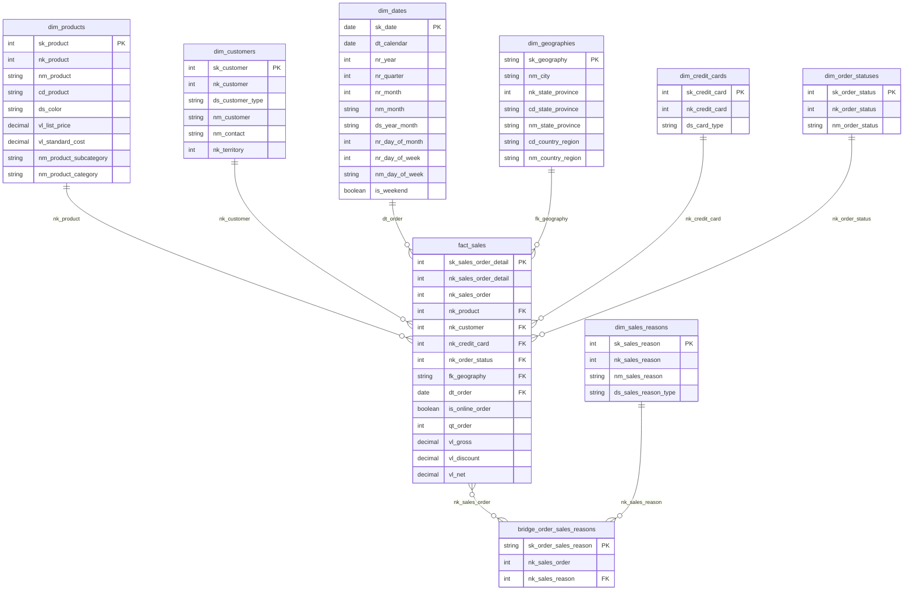

# Conceptual model (star schema)

The `fact_sales` fact sits in the center, at sales order line grain. The dimensions link to the fact through the natural key (`nk_`) or, for geography, through a composite key (`fk_geography`). Sales reasons link through a bridge table, because the relationship is many-to-many.

## Diagram

## Source of each table

All sources are in the `adventure_works` schema. The `staging` layer has one `stg_` model per source table.

| Model table | Source tables (`adventure_works` schema) | Note |
|---|---|---|
| `fact_sales` | `salesorderdetail`, `salesorderheader`, `address` | Order line grain. Geography comes from the ship-to address |
| `dim_products` | `product`, `productsubcategory`, `productcategory` | Product with subcategory and category |
| `dim_customers` | `customer`, `store`, `person` | Store when there is a `storeid`, person otherwise |
| `dim_dates` | No source (generated with `dbt_utils.date_spine`) | From 2011-01-01 to 2014-12-31 |
| `dim_geographies` | `address`, `stateprovince`, `countryregion` | City, state and country |
| `dim_credit_cards` | `creditcard` | Plus the "Unknown" member (`-1`) |
| `dim_order_statuses` | No source (codes defined in the model) | Codes 1 to 6 of the header `status` |
| `dim_sales_reasons` | `salesreason` | Plus the "No reason" member (`-1`) |
| `bridge_order_sales_reasons` | `salesorderheader`, `salesorderheadersalesreason` | An order without a reason points to "No reason" |

## Reading the model

- **Fact:** `fact_sales` holds additive measures (`qt_order`, `vl_gross`, `vl_discount`, `vl_net`). The number of orders is a distinct count of `nk_sales_order`.
- **Dimensions:** each one has a `sk_` primary key. In single-column dimensions, the `sk_` is the renamed natural key.
- **Bridge:** `bridge_order_sales_reasons` links orders to reasons. The sum by reason does not match the fact total, by design.
