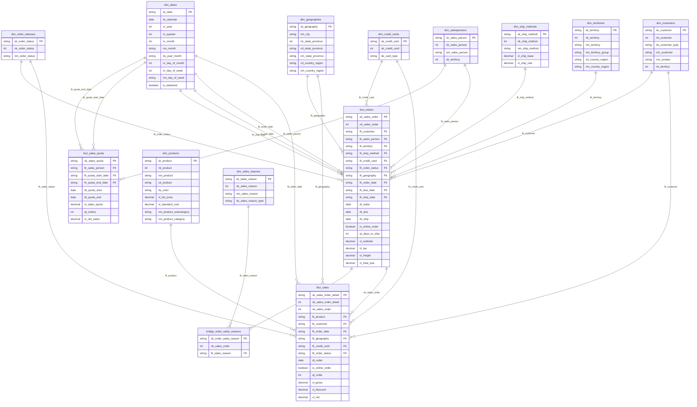

# Conceptual model (star schema)

The model has three fact tables, ten dimensions and one bridge table. `fact_sales` (order line grain) and `fact_orders` (order grain) share the same dimensions, and `fact_sales_quota` (salesperson and quota period grain) measures the sales against the quotas. Sales reasons link through a bridge table, because the relationship is many-to-many.

## Keys

- **`sk_`**: surrogate primary key of every table. It is a hash created with `generate_surrogate_key` over the natural key, in the model that owns the key.
- **`nk_`**: natural key from the source. The facts keep only the natural keys of their own grain (`nk_sales_order` and `nk_sales_order_detail`).
- **`fk_`**: foreign key. It is never hashed in the fact: the fact joins the dimension by the natural key and takes the `sk_` of the dimension.

## Diagram

`dim_dates` is a role-playing dimension: it links three times to `fact_orders` (order, due and ship dates) and twice to `fact_sales_quota` (start and end of the quota period).

## Source of each table

All sources are in the `adventure_works` schema. The `staging` layer has one `stg_` model per source table.

| Model table | Source tables (`adventure_works` schema) | Note |
|---|---|---|
| `fact_sales` | `salesorderdetail`, `salesorderheader`, `address` | Order line grain. Geography comes from the ship-to address |
| `fact_orders` | `salesorderheader`, `address` | Order grain. The only place with freight, tax and the days to ship |
| `fact_sales_quota` | `salespersonquotahistory`, plus the net sales from `fact_orders` | Salesperson and quota period grain |
| `dim_products` | `product`, `productsubcategory`, `productcategory` | Product with subcategory and category |
| `dim_customers` | `customer`, `store`, `person` | Store when there is a `storeid`, person otherwise |
| `dim_dates` | No source (generated with `dbt_utils.date_spine`) | From 2011-01-01 to 2014-12-31 |
| `dim_geographies` | `address`, `stateprovince`, `countryregion` | City, state and country |
| `dim_credit_cards` | `creditcard` | Plus the "Unknown" member (`-1`) |
| `dim_order_statuses` | No source (codes defined in the model) | Codes 1 to 6 of the header `status` |
| `dim_salespersons` | `salesperson`, `person` | Plus the "No salesperson" member (`-1`) for online orders |
| `dim_territories` | `salesterritory`, `countryregion` | Territory with sales group and country |
| `dim_ship_methods` | `shipmethod` | Shipping methods with base charge and rate |
| `dim_sales_reasons` | `salesreason` | Plus the "No reason" member (`-1`) |
| `bridge_order_sales_reasons` | `salesorderheader`, `salesorderheadersalesreason` | An order without a reason points to "No reason" |

## Reading the model

- **Facts:** `fact_sales` and `fact_orders` are linked by the order (`nk_sales_order`). Freight and tax exist only in `fact_orders` and must not be mixed with the line amounts of `fact_sales`. The number of orders is a distinct count of `nk_sales_order` in `fact_sales`, or a row count in `fact_orders`.
- **Quota:** `fact_sales_quota` holds the quota (`vl_sales_quota`) and the net sales of the salesperson in the same period (`vl_net_sales`, taken from the order subtotal in `fact_orders`). Quota attainment is `vl_net_sales / vl_sales_quota`, calculated in the query or in the BI. All 3,806 salesperson orders fall in some quota period, and online orders have no salesperson.
- **Dimensions:** each one has a hashed `sk_` primary key. `dim_customers` and `dim_salespersons` keep `nk_territory` as an attribute, without a foreign key to `dim_territories`.
- **Bridge:** `bridge_order_sales_reasons` links orders to reasons. The sum by reason does not match the fact total, by design.

## Not modeled yet

Product cost and margin, and special offers (discount programs), are not in the repository and are not in the diagram.
